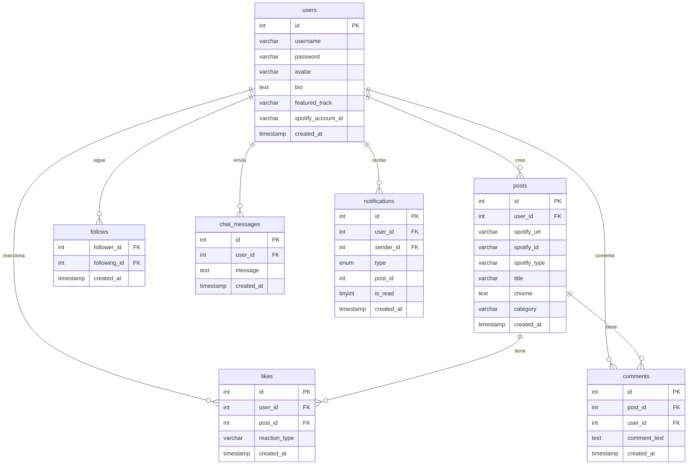

# 🎧 DJ CHISMOSO

> **La red social definitiva para descubrir música y compartir chismes sobre tus playlists de Spotify.**

DJ CHISMOSO es una Single-Page Application (SPA) estilo red social en la que los usuarios pueden compartir canciones, playlists y álbumes de Spotify acompañados de un *chisme musical* — una reseña informal y entretenida. Los demás usuarios pueden reaccionar, comentar, seguir perfiles y chatear en vivo.

---

## 🌐 Demo en vivo

**🔗 [quirozweb.com](https://quirozweb.com)**

---

## ✨ Características

### 📰 Feed Social
- Feed principal con publicaciones de toda la comunidad, con filtros por **Reciente**, **Tendencias** y **Siguiendo**.
- Buscador global en tiempo real (busca por título, artista, usuario o categoría).
- Filtro por categoría musical: Rock, Pop, Indie, Gym, Estudio, Gaming, Triste, Electrónica, etc.
- Filtro por tipo de contenido de Spotify: Canción, Playlist o Álbum.

### 🎵 Integración con Spotify
- Embed del reproductor oficial de Spotify directamente en cada publicación.
- Soporte para compartir **tracks**, **playlists** y **álbumes**.
- Vinculación de cuenta de Spotify mediante **OAuth 2.0** para mostrar tu perfil oficial.
- Cola de reproducción interna para escuchar sin interrupciones.
- Soporte para URLs cortas de `spotify.link`, URLs de `open.spotify.com` y URIs `spotify:track:ID`.

### 👤 Perfiles de Usuario
- Registro e inicio de sesión con nombre de usuario y contraseña.
- Perfil personalizable: avatar emoji, biografía y canción insignia de Spotify.
- Vista del perfil con todas las publicaciones del usuario.
- Sistema de **seguidores / siguiendo**.

### 💬 Interacción Social
- **Reacciones** con 5 emojis: ❤️ Heart, 🔥 Fire, 😢 Cry, 😮 Wow, 💃 Dance.
- Sección de **comentarios** por publicación.
- Sistema de **notificaciones** en tiempo real (likes, comentarios, nuevos seguidores).
- **El Chismógrafo**: chat en vivo comunitario para todos los usuarios registrados.

### 📊 Rankings y Tendencias
- Ranking de publicaciones más populares.
- Sección de tendencias con las categorías y artistas del momento.

---

## 🛠️ Stack Tecnológico

| Capa | Tecnología |
|------|-----------|
| **Frontend** | HTML5, CSS3, JavaScript (Vanilla ES6+) |
| **Backend** | PHP 8+ |
| **Base de Datos** | MySQL (PDO) |
| **Framework CSS** | Bootstrap 5.3 |
| **Iconos** | Font Awesome 6.4 |
| **Fuentes** | Google Fonts (Outfit, Plus Jakarta Sans) |
| **API Externa** | Spotify Web API (OAuth 2.0, Embed Player) |
| **Hosting** | Hostinger (Shared Hosting) |

---

## 📁 Estructura del Proyecto

```
hosting/
├── index.php          # Vista principal SPA — esqueleto HTML, layout y carga de recursos
├── app.js             # Controlador del frontend — estado, enrutamiento de vistas, AJAX
├── styles.css         # Estilos personalizados — diseño oscuro con gradientes y animaciones
├── api.php            # API REST en JSON — toda la lógica de backend
├── config.php         # Configuración de base de datos y sesiones (credenciales Hostinger)
├── db_setup.php       # Instalador automático — crea las tablas y datos de prueba vía browser
├── dj_chismoso.sql    # Script SQL completo para importar vía phpMyAdmin
└── generar_hash.php   # Utilidad para generar hashes bcrypt de contraseñas
```

---

## 🗄️ Esquema de Base de Datos



---

## 🚀 Instalación en Hostinger

### Pre-requisitos
- Hosting con soporte de **PHP 8+** y extensión **cURL** habilitada.
- Base de datos **MySQL** creada desde el panel de Hostinger (hPanel).
- Credenciales de la **Spotify Developer API** (Client ID y Client Secret).

### Pasos

**1. Sube los archivos al servidor**
```
Sube todos los archivos a la carpeta public_html de tu dominio.
```

**2. Crea la base de datos en hPanel**
```
hPanel → Bases de datos → MySQL → Crear base de datos y usuario
```

**3. Configura las credenciales en `config.php`**
```php
define('DB_HOST', 'localhost');
define('DB_USER', 'tu_usuario_mysql');
define('DB_PASS', 'tu_contraseña');
define('DB_NAME', 'tu_base_de_datos');

define('SPOTIFY_CLIENT_ID',     'tu_client_id');
define('SPOTIFY_CLIENT_SECRET', 'tu_client_secret');
define('SPOTIFY_REDIRECT_URI',  'https://tu-dominio.com/api.php?action=spotify_callback');
```

**4. Instala la base de datos**

**Opción A — Instalador automático (recomendado):**
```
Visita https://tu-dominio.com/db_setup.php desde el navegador.
El instalador creará todas las tablas y los datos de prueba automáticamente.
```

**Opción B — phpMyAdmin manual:**
```
En phpMyAdmin, selecciona tu BD → pestaña "Importar" → sube dj_chismoso.sql
```

**5. Configura la Spotify Developer App**

Accede a [Spotify Developer Dashboard](https://developer.spotify.com/dashboard) y en tu aplicación:
- Agrega como **Redirect URI**: `https://tu-dominio.com/api.php?action=spotify_callback`

**6. ¡Listo!**
```
Visita https://tu-dominio.com
```

---

## 🔑 Cuentas de Prueba

> **Contraseña para todos:** `123456`

| Usuario | Avatar | Bio |
|---------|--------|-----|
| `dj_chismoso` | 🎧 | El DJ oficial del chisme musical |
| `el_rockero_99` | 🎸 | Amante del rock clásico |
| `indie_girl` | 🌸 | Descubriendo bandas indie |
| `lofi_relaxer` | ☕ | Beats suaves 24/7 |
| `gym_beast_88` | ⚡ | Energía para el gimnasio |

---

## 📡 Endpoints de la API (`api.php`)

Todos los endpoints responden en `Content-Type: application/json`.

### Autenticación
| Método | Acción | Descripción |
|--------|--------|-------------|
| `GET` | `get_session` | Obtiene la sesión activa del usuario |
| `POST` | `login` | Iniciar sesión |
| `POST` | `register` | Registrar nuevo usuario |
| `GET/POST` | `logout` | Cerrar sesión |
| `POST` | `update_profile` | Editar avatar, bio y canción insignia |

### Spotify OAuth
| Método | Acción | Descripción |
|--------|--------|-------------|
| `GET` | `spotify_login` | Genera URL de autorización OAuth |
| `GET` | `spotify_callback` | Callback — vincula la cuenta de Spotify |
| `POST` | `unlink_spotify` | Desvincula la cuenta de Spotify |

### Publicaciones
| Método | Acción | Descripción |
|--------|--------|-------------|
| `GET` | `get_posts` | Lista publicaciones (con filtros de categoría, búsqueda, orden) |
| `POST` | `create_post` | Crear nueva publicación con enlace de Spotify |

### Reacciones y Comentarios
| Método | Acción | Descripción |
|--------|--------|-------------|
| `POST` | `toggle_reaction` | Agregar / cambiar / quitar reacción (heart, fire, cry, wow, dance) |
| `GET` | `get_comments` | Obtener comentarios de una publicación |
| `POST` | `add_comment` | Publicar un comentario |

### Social
| Método | Acción | Descripción |
|--------|--------|-------------|
| `GET` | `get_profile` | Obtener perfil de un usuario |
| `POST` | `toggle_follow` | Seguir / dejar de seguir a un usuario |
| `GET` | `get_rankings` | Publicaciones más populares |
| `GET` | `get_trends` | Tendencias de categorías |

### Chat y Notificaciones
| Método | Acción | Descripción |
|--------|--------|-------------|
| `GET` | `get_chat_messages` | Obtener mensajes del chat en vivo |
| `POST` | `send_chat_message` | Enviar mensaje al Chismógrafo |
| `GET` | `get_notifications` | Obtener notificaciones del usuario |
| `POST` | `mark_notifications_read` | Marcar notificaciones como leídas |

---

## 📄 Licencia

Este proyecto es de código abierto.

---

<div align="center">
  Hecho con 🎧 y muchos chismes musicales por <a href="https://github.com/JunioKazama">JunioKazama</a>
</div>
