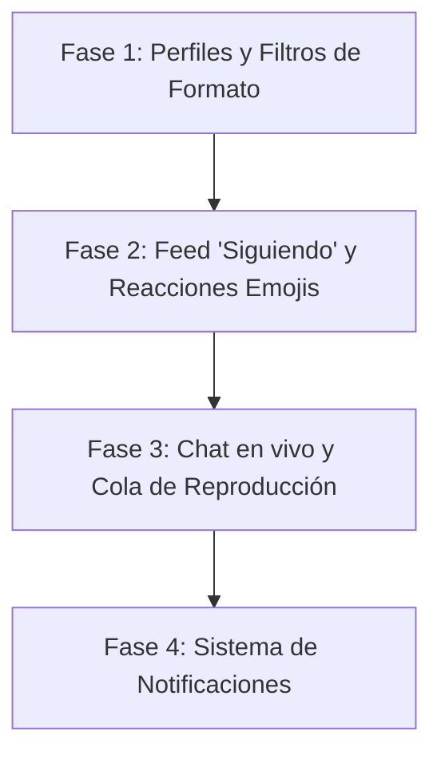

# Plan de Implementación: DJ CHISMOSO - Nuevas Funcionalidades

Este plan detalla el diseño e implementación de las nuevas características sugeridas para **DJ CHISMOSO**:

1. **Editar Perfil y "Canción Insignia"**
2. **Filtros de Formato de Spotify** (Canciones, Álbumes, Playlists)
3. **Feed Personalizado ("Siguiendo")**
4. **Reacciones con Emojis en Publicaciones**
5. **Chat en vivo ("El Chismógrafo")**
6. **Sistema de Notificaciones Activas** (Campana en Header)
7. **Cola de Reproducción y Player Avanzado**

Para asegurar la estabilidad, dividiremos el trabajo en **4 fases secuenciales**.

---

## User Review Required

> [!IMPORTANT]
> **Cambios en Base de Datos:** La implementación de estas características requiere agregar nuevas tablas (`chat_messages`, `notifications`) y modificar tablas existentes (`users` y `likes`). Crearemos scripts de migración automáticos para que no pierdas ningún dato existente al ejecutar las actualizaciones de base de datos.

---

## Plan de Fases

---

## Proposed Changes

### FASE 1: Perfiles Renovados y Filtros de Formato
Esta fase se enfoca en permitir que los DJs editen su perfil, seleccionen su "canción del día/insignia", y que podamos filtrar chismes en el feed según si son canciones, listas o álbumes.

#### [MODIFY] [db_setup.php](file:///c:/Users/felig/OneDrive/Documentos/DJ%20CHISMOSO/db_setup.php)
* Modificar el esquema de la tabla `users` para añadir la columna `featured_track` (VARCHAR(500) DEFAULT NULL) para guardar el enlace de su canción insignia.

#### [MODIFY] [api.php](file:///c:/Users/felig/OneDrive/Documentos/DJ%20CHISMOSO/api.php)
* **Nueva acción `update_profile`**: Recibe `bio`, `avatar` (emoji) y `featured_track` (opcional). Valida y actualiza en la base de datos para el usuario logueado.
* **Modificar acción `get_posts`**: Añadir parámetro opcional `spotify_type` ('track', 'playlist', 'album') para filtrar chismes por su formato.
* **Modificar acción `get_profile`**: Incluir la columna `featured_track` en la información devuelta del usuario.

#### [MODIFY] [index.php](file:///c:/Users/felig/OneDrive/Documentos/DJ%20CHISMOSO/index.php)
* **Modal de Edición de Perfil (`modal-edit-profile`)**: Formulario con entrada para bio, selección de avatar emoji y URL de Spotify para canción insignia.
* **Contenedores de Filtros**: Agregar selectores visuales rápidos de formato (🎵 Canciones, 📂 Playlists, 💿 Álbumes) debajo de la barra de búsqueda o arriba del feed.

#### [MODIFY] [app.js](file:///c:/Users/felig/OneDrive/Documentos/DJ%20CHISMOSO/app.js)
* **Manejar Filtros de Formato**: Actualizar `AppState` para almacenar `currentSpotifyType`. Integrar el filtro al refrescar el feed.
* **Renderizar Perfil**: Si el perfil tiene `featured_track`, incrustar un mini reproductor de Spotify dinámico en la cabecera del perfil.
* **Edición de Perfil**: Vincular botón de "Editar Perfil" (visible solo en perfil propio), rellenar modal con datos actuales y enviar mediante Fetch a `api.php?action=update_profile`.

---

### FASE 2: Feed Personalizado y Reacciones con Emojis
Añadiremos mayor interactividad permitiendo reacciones emocionales y un feed enfocado en la red de contactos del DJ.

#### [MODIFY] [db_setup.php](file:///c:/Users/felig/OneDrive/Documentos/DJ%20CHISMOSO/db_setup.php)
* Modificar la tabla `likes` para renombrarla o agregarle la columna `reaction_type` VARCHAR(20) DEFAULT 'heart' para guardar el emoji de reacción (❤️, 🔥, 😭, 😱, 🕺).

#### [MODIFY] [api.php](file:///c:/Users/felig/OneDrive/Documentos/DJ%20CHISMOSO/api.php)
* **Modificar acción `get_posts`**: Si el filtro es `following` y el usuario está logueado, modificar la query SQL para filtrar solo posts creados por usuarios seguidos (`following_id` en `follows`).
* **Actualizar conteo de Likes a Reacciones**: Modificar las consultas para devolver el desglose de reacciones por post (o el total y el tipo de reacción que dio el usuario actual).
* **Modificar acción `toggle_like` (ahora `toggle_reaction`)**: Aceptar el parámetro `reaction_type` y guardar/reemplazar la reacción del usuario.

#### [MODIFY] [index.php](file:///c:/Users/felig/OneDrive/Documentos/DJ%20CHISMOSO/index.php)
* **Añadir pestaña "Seguidos"** en el feed central.
* **Panel de Reacciones**: Modificar la barra de acciones del post para que al pasar el mouse por encima o presionar el botón de Like, despliegue un menú flotante con los 5 emojis de reacción.

#### [MODIFY] [app.js](file:///c:/Users/felig/OneDrive/Documentos/DJ%20CHISMOSO/app.js)
* **Lógica de Reacciones**: Implementar el menú hover/click para enviar reacciones específicas. Actualizar la UI del post para mostrar el emoji correspondiente activo y la cuenta.
* **Manejo de la pestaña "Seguidos"**: Cambiar filtro en `AppState` y volver a cargar el feed.

---

### FASE 3: Chat en vivo ("El Chismógrafo") y Cola de Reproducción
Haremos dinámico el panel de actividad y mejoraremos las opciones de audio continuo.

#### [NEW] [db_setup.php](file:///c:/Users/felig/OneDrive/Documentos/DJ%20CHISMOSO/db_setup.php)
* Crear la tabla `chat_messages` con columnas: `id`, `user_id`, `message`, `created_at`.

#### [MODIFY] [api.php](file:///c:/Users/felig/OneDrive/Documentos/DJ%20CHISMOSO/api.php)
* **Acción `get_chat_messages`**: Devuelve los últimos 40 mensajes de chat ordenados por fecha, incluyendo avatar y username del emisor.
* **Acción `send_chat_message`**: Recibe y sanitiza `message`. Lo guarda vinculado al `user_id` en sesión.

#### [MODIFY] [index.php](file:///c:/Users/felig/OneDrive/Documentos/DJ%20CHISMOSO/index.php)
* **Caja de Chat en Sidebar Derecho**: Reemplazar o expandir el panel "DJ Activos en Sala" por un contenedor de chat con área de scroll para mensajes y una barra inferior para escribir (para usuarios logueados).
* **Panel de Cola de Reproducción**: Agregar un ícono de lista de reproducción en la persistent player bar que abra un pequeño panel lateral/flotante con las canciones en cola.

#### [MODIFY] [app.js](file:///c:/Users/felig/OneDrive/Documentos/DJ%20CHISMOSO/app.js)
* **Chat Polling**: Crear una rutina de sondeo (`setInterval` de 3-4 segundos) que llame a `api.php?action=get_chat_messages` y actualice el chat solo si hay nuevos mensajes.
* **Cola de Reproducción**:
  * Implementar variables `AppState.playbackQueue` (arreglo de canciones) y `AppState.currentQueueIndex`.
  * Añadir botones en las tarjetas de post: "Escuchar ahora" y "Añadir a la cola".
  * Integrar lógica de "Siguiente" en el reproductor flotante.

---

### FASE 4: Sistema de Notificaciones Activas
Mantendremos al usuario al tanto de lo que pasa con su contenido.

#### [NEW] [db_setup.php](file:///c:/Users/felig/OneDrive/Documentos/DJ%20CHISMOSO/db_setup.php)
* Crear tabla `notifications` con columnas: `id`, `user_id` (quien recibe), `sender_id` (quien causa), `type` ('like', 'comment', 'follow'), `post_id` (opcional), `is_read`, `created_at`.

#### [MODIFY] [api.php](file:///c:/Users/felig/OneDrive/Documentos/DJ%20CHISMOSO/api.php)
* **Acción `get_notifications`**: Devuelve las notificaciones recientes del usuario actual.
* **Acción `mark_notifications_read`**: Marca todas como leídas.
* **Lógica del Servidor**: Insertar registros en `notifications` automáticamente al recibir comentarios, likes/reacciones o follows.

#### [MODIFY] [index.php](file:///c:/Users/felig/OneDrive/Documentos/DJ%20CHISMOSO/index.php)
* **Ícono de Campana con Badge en el Header**: Cerca del perfil de usuario, un ícono que muestre un círculo rojo con el número de notificaciones pendientes. Al hacer clic, abre un menú desplegable (dropdown) con la lista de notificaciones.

#### [MODIFY] [app.js](file:///c:/Users/felig/OneDrive/Documentos/DJ%20CHISMOSO/app.js)
* Cargar notificaciones al inicializar la sesión y cada 10 segundos.
* Renderizar notificaciones de forma legible (ej. *"@el_rockero_99 ha comentado tu chisme 'Himnos del Rock'"*).
* Permitir hacer clic en la notificación para abrir directamente el modal de comentarios del post respectivo o el perfil del usuario.

---

## Verification Plan

### Automated/Manual verification
- Ejecutaremos pruebas locales recargando la base de datos a través de [db_setup.php](file:///c:/Users/felig/OneDrive/Documentos/DJ%20CHISMOSO/db_setup.php) para asegurar que las nuevas tablas y columnas se crean correctamente y que los "seeds" de ejemplo funcionan.
- Realizaremos pruebas del flujo de registro/login, edición de perfil y validación de las URLs de Spotify para la canción insignia.
- Validaremos las peticiones a la API para chat en vivo y notificaciones verificando las respuestas JSON desde el navegador.
- Comprobaremos la visualización responsive de los nuevos elementos (chat lateral, barra de notificaciones y panel de cola en pantallas móviles y de escritorio).
